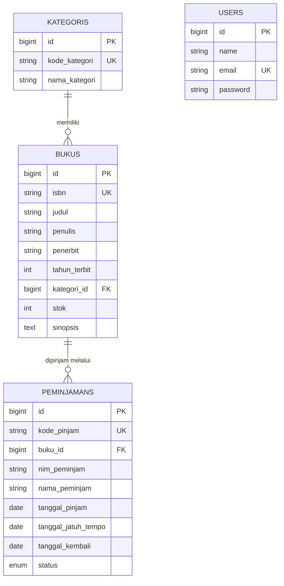
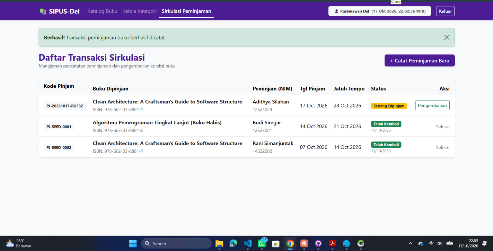
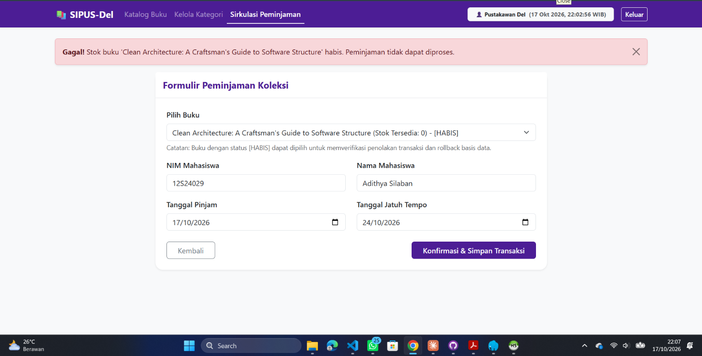
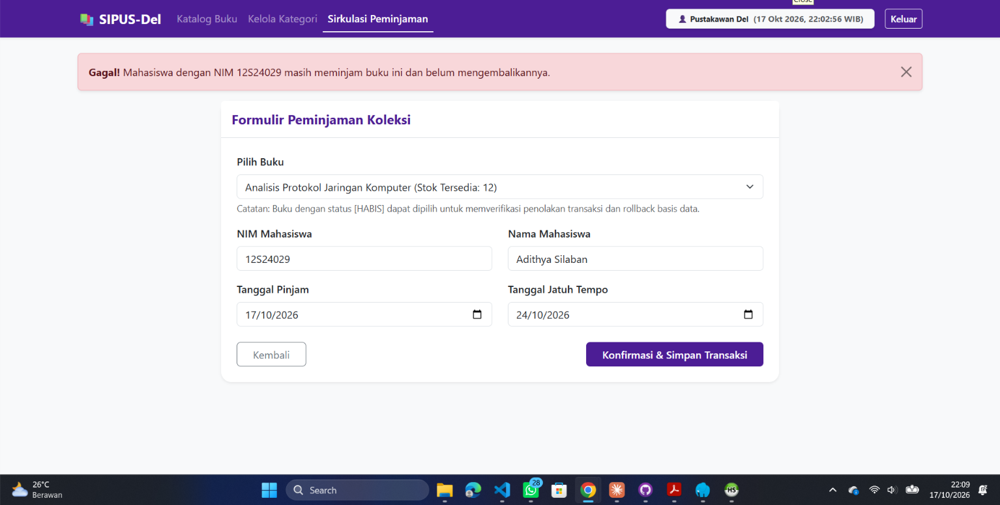
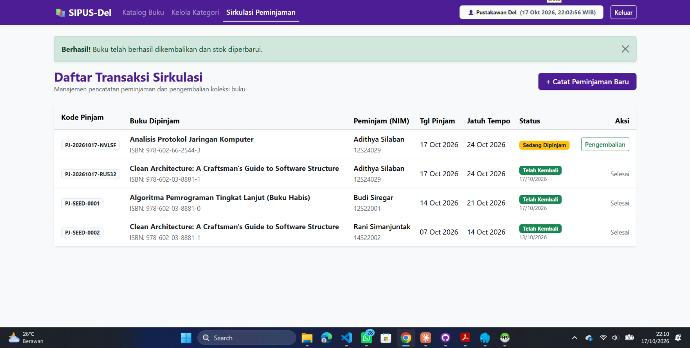
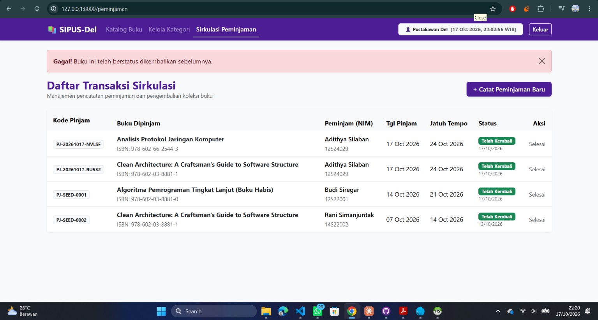
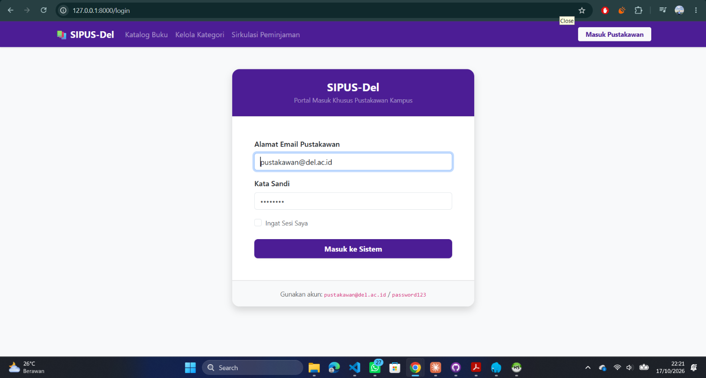
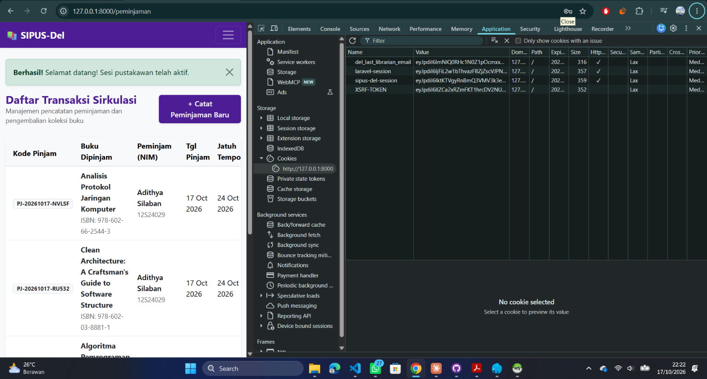

# SIPUS-Del — Sistem Informasi Perpustakaan Kampus Del

**Tugas Mandiri Minggu 5 dan Minggu 6 (Tahap 2) — 12S3101 Pemrograman & Pengujian Web (PPW)**
Institut Teknologi Del · Semester Ganjil 2026/2027

| Identitas | Keterangan |
| :--- | :--- |
| **Nama** | Adithya Philip Jona Putra Silaban |
| **NIM** | 12S24029 |
| **Program Studi** | Sarjana Sistem Informasi |
| **Dosen Pengampu** | Chandro Pardede, S.Kom., M.Sc. |
| **Repositori** | `ppw-2026-week5-12S24029` |
| **Branch Minggu 5** | `main` |
| **Branch Minggu 6 (Tahap 2)** | `week6-db-session` — <https://github.com/AdithyaSilaban/ppw-2026-week5-12S24029/tree/week6-db-session> |

> Branch `week6-db-session` memuat seluruh pekerjaan Minggu 5 ditambah Tahap 2 (Minggu 6). README ini menjelaskan keduanya.

## Akun Uji Pustakawan

| Email | Kata sandi | Hak akses |
| :--- | :--- | :--- |
| `pustakawan@del.ac.id` | `password123` | Tambah/ubah/hapus buku dan kategori, peminjaman, pengembalian |

Pengunjung tanpa login hanya dapat melihat katalog buku, detail buku, dan kategori.

---

## 1. Deskripsi Singkat

SIPUS-Del adalah aplikasi web perpustakaan kampus berbasis **Laravel 11.x** dengan arsitektur **MVC** dan *server-side rendering* (Blade).

**Cakupan Minggu 5:** master data Kategori dan Buku, Eloquent ORM (relasi, `$fillable`, eager loading), routing RESTful, validasi server-side, CSRF, dan Blade Component.

**Cakupan Minggu 6 (Tahap 2):**

- Tabel transaksi `peminjamans` dan relasi Eloquent
- Peminjaman dan pengembalian buku dengan **transaksi ACID** (`DB::transaction` + `lockForUpdate`)
- Statistik perpustakaan dengan **Fluent Query Builder** (`DB::table`), `withCount`, filter dinamis `when()`, dan paginasi `withQueryString()`
- **Autentikasi pustakawan** (`Auth::attempt`), **Session**, **Cookie**, dan proteksi rute dengan middleware `auth`

## 2. Teknologi

| Komponen | Versi / Keterangan |
| :--- | :--- |
| Bahasa | PHP 8.4 |
| Framework | Laravel 13 |
| Basis data | SQLite (default lokal); kompatibel dengan MySQL 8.0 (InnoDB) |
| Session driver | `database` (tabel `sessions`) |
| Dependency manager | Composer 2.6+ |
| Frontend | Bootstrap 5.3.3 via CDN, tema **Del Purple `#4C1D95`** |
| Tooling | Artisan CLI, Git (Conventional Commits) |

## 3. Fitur

**Katalog dan master data**

- Katalog buku dengan pencarian (judul/penulis/ISBN), filter kategori, paginasi, jumlah peminjaman per buku, dan 4 kartu statistik
- Detail buku; riwayat sirkulasi (data peminjam) hanya tampil untuk pustakawan yang login
- CRUD buku dan kategori; kategori yang masih memuat buku tidak dapat dihapus, begitu pula buku yang masih dipinjam

**Sirkulasi (khusus pustakawan)**

- Pencatatan peminjaman dengan penolakan otomatis jika stok habis atau NIM yang sama masih meminjam buku yang sama
- Pengembalian buku yang memulihkan stok dan mencegah pengembalian ganda
- Daftar transaksi dengan penanda jatuh tempo

**Autentikasi**

- Login dan logout aman, session state (waktu login tampil di navbar), dan cookie email pustakawan terakhir

## 4. Skema Basis Data dan ERD



Tabel `users` dan `sessions` berasal dari migrasi bawaan Laravel (autentikasi dan session database).

### Tabel `kategoris`

| Kolom | Tipe | Keterangan |
| :--- | :--- | :--- |
| `id` | bigint, PK | |
| `kode_kategori` | string(20) | unique |
| `nama_kategori` | string(100) | |

### Tabel `bukus`

| Kolom | Tipe | Keterangan |
| :--- | :--- | :--- |
| `id` | bigint, PK | |
| `isbn` | string(20) | unique |
| `judul` | string(200) | |
| `penulis`, `penerbit` | string(150) | |
| `tahun_terbit` | integer | |
| `kategori_id` | FK → `kategoris.id` | `cascadeOnDelete` |
| `stok` | integer | default 0 |
| `sinopsis` | text | nullable |

### Tabel `peminjamans` (Minggu 6)

| Kolom | Tipe | Keterangan |
| :--- | :--- | :--- |
| `id` | bigint, PK | |
| `kode_pinjam` | string(30) | unique, format `PJ-YYYYMMDD-XXXXX` |
| `buku_id` | FK → `bukus.id` | `cascadeOnDelete` |
| `nim_peminjam` | string(15) | |
| `nama_peminjam` | string(150) | |
| `tanggal_pinjam` | date | |
| `tanggal_jatuh_tempo` | date | |
| `tanggal_kembali` | date | nullable, terisi saat pengembalian |
| `status` | enum | `dipinjam` (default) / `dikembalikan` |

**Relasi Eloquent:** `Kategori` hasMany `Buku`; `Buku` belongsTo `Kategori`; `Buku` hasMany `Peminjaman`; `Peminjaman` belongsTo `Buku`.

**Integritas hapus:**

1. Lapisan aplikasi: `KategoriController@destroy` menolak jika masih ada buku; `BukuController@destroy` menolak jika ada peminjaman berstatus `dipinjam`.
2. Lapisan basis data: foreign key memakai `cascadeOnDelete` sebagai jaring pengaman. Menghapus buku yang tidak sedang dipinjam ikut menghapus riwayat peminjamannya.

## 5. Struktur MVC dan Routing

| Lapisan | Lokasi |
| :--- | :--- |
| Model | `app/Models/Kategori.php`, `Buku.php`, `Peminjaman.php` |
| View | `resources/views/{buku,kategori,peminjaman,auth}/` |
| Controller | `BukuController`, `KategoriController`, `PeminjamanController`, `AuthController` |
| Layout | `resources/views/components/layout.blade.php` (`<x-layout>`) |

### Peta rute dan hak akses

| Method | URI | Aksi | Akses |
| :--- | :--- | :--- | :--- |
| GET | `/buku`, `/buku/{buku}` | `index`, `show` | Publik |
| GET | `/kategori`, `/kategori/{kategori}` | `index`, `show` | Publik |
| GET/POST | `/login` | `showLoginForm`, `login` | Tamu (`guest`) |
| POST | `/logout` | `logout` | `auth` |
| GET, POST | `/buku/create`, `/buku` | `create`, `store` | `auth` |
| GET, PUT/PATCH, DELETE | `/buku/{buku}/edit`, `/buku/{buku}` | `edit`, `update`, `destroy` | `auth` |
| (pola yang sama) | `/kategori...` | CRUD kategori | `auth` |
| GET | `/peminjaman` | `index` | `auth` |
| GET, POST | `/peminjaman/create`, `/peminjaman` | `create`, `store` | `auth` |
| PATCH | `/peminjaman/{peminjaman}/kembalikan` | `kembalikan` | `auth` |

Semua parameter rute memakai **Implicit Route Model Binding**. Rute `show` dibatasi `whereNumber(...)` agar `/buku/create` dan `/kategori/create` tidak tertangkap sebagai `{buku}`/`{kategori}`.

## 6. Transaksi ACID dan Concurrency Locking

### Peminjaman (`PeminjamanController@store`)

Seluruh langkah berjalan di dalam `DB::transaction()`:

1. Validasi input, lalu NIM dinormalisasi (`trim` + huruf besar).
2. `Buku::where('id', ...)->lockForUpdate()->firstOrFail()` mengunci baris buku.
3. Jika `stok <= 0`: transaksi dibatalkan (rollback) dengan pesan galat.
4. Jika NIM yang sama masih meminjam buku yang sama (`status = 'dipinjam'`): transaksi dibatalkan.
5. Insert ke `peminjamans`, lalu `$buku->decrement('stok')`.

### Pengembalian (`PeminjamanController@kembalikan`)

1. Kunci baris `peminjaman`; jika sudah `dikembalikan`, tolak (mencegah stok bertambah dua kali).
2. Kunci baris `buku` terkait.
3. Ubah `status` menjadi `dikembalikan`, isi `tanggal_kembali`, lalu `$buku->increment('stok')`.

### Penanganan galat

- Kegagalan aturan bisnis (stok habis, pinjam ganda, sudah dikembalikan) dilempar sebagai `RuntimeException` dan ditampilkan sebagai flash `error`.
- `QueryException` ditangkap dan dicatat dengan `Log::error('[DB EXCEPTION] ...')`; pengguna hanya menerima pesan umum, bukan detail SQL.

> **Catatan SQLite:** `lockForUpdate()` tidak menghasilkan row-level lock pada SQLite (tidak didukung; penulisan diserialisasi pada level basis data). Penguncian baris yang sesungguhnya efektif pada **MySQL/InnoDB**. Logika aplikasi (periksa stok setelah lock, di dalam transaksi) sama untuk kedua mesin.

## 7. Query Builder, `withCount`, dan Filter Dinamis

**Kartu statistik** (`BukuController@index`, memakai `DB::table`):

```php
$stats = [
    'total_judul'     => DB::table('bukus')->count(),
    'total_stok'      => (int) DB::table('bukus')->sum('stok'),
    'sedang_dipinjam' => DB::table('peminjamans')->where('status', 'dipinjam')->count(),
    'dikembalikan'    => DB::table('peminjamans')->where('status', 'dikembalikan')->count(),
];
```

**Katalog:** `Buku::with('kategori')->withCount('peminjamans')`, filter kategori dan pencarian (judul/penulis/ISBN, dikelompokkan dalam closure) dengan `when()`, serta `paginate(10)->withQueryString()` agar filter tetap terbawa antarhalaman.

**Daftar sirkulasi:** `Peminjaman::with('buku')->latest()->paginate(10)`.

## 8. Session, Cookie, dan Autentikasi

| Mekanisme | Implementasi |
| :--- | :--- |
| Login | `Auth::attempt()` dengan opsi `remember`; setelah berhasil, pengguna dialihkan ke URL tujuan semula (`redirect()->intended`) |
| Anti Session Fixation | `$request->session()->regenerate()` saat login |
| Logout | `POST /logout` + `Auth::logout()`, `session()->invalidate()`, `session()->regenerateToken()` |
| Session state | `login_timestamp` disimpan di session dan ditampilkan di navbar |
| HTTP Cookie | `Cookie::queue('del_last_librarian_email', ..., 10080)` (7 hari) untuk mengisi otomatis email di form login |
| Proteksi rute | Middleware `auth` pada seluruh rute mutasi dan sirkulasi; `guest` pada halaman login |
| Pembatasan percobaan login | Throttling pada `POST /login` untuk menghambat tebakan kata sandi berulang |

Cookie sesi dan cookie email pustakawan dikirim dengan flag **HttpOnly** dan `SameSite=Lax`; nilainya terenkripsi oleh Laravel. Session disimpan di tabel `sessions` (`SESSION_DRIVER=database`). Bukti inspeksi DevTools ada di bagian 12.7.

## 9. Validasi dan Keamanan

**Buku (`store` dan `update`)**

| Field | Aturan |
| :--- | :--- |
| `isbn` | wajib, maks 20, unik (saat `update` mengecualikan ID sendiri) |
| `judul` | wajib, **minimal 5**, maks 200 |
| `penulis`, `penerbit` | wajib, maks 150 |
| `tahun_terbit` | wajib, integer 4 digit, 1900 s.d. tahun berjalan + 1 |
| `kategori_id` | wajib, ada di tabel `kategoris` |
| `stok` | wajib, integer, minimal 0 |
| `sinopsis` | opsional |

**Kategori:** `kode_kategori` wajib, maks 20, unik (kecuali ID sendiri); `nama_kategori` wajib, maks 100.

**Peminjaman:** `buku_id` ada di `bukus`; `nim_peminjam` maks 15; `nama_peminjam` maks 150; `tanggal_pinjam` bertipe date; `tanggal_jatuh_tempo` bertipe date dan tidak lebih awal dari tanggal pinjam.

**Langkah keamanan**

- CSRF: semua form memuat `@csrf`; ubah, hapus, dan pengembalian memakai `@method('PUT' / 'DELETE' / 'PATCH')`; logout berupa form `POST`
- `$fillable` pada semua model; `create()`/`update()` hanya menerima data hasil validasi
- Output di-escape dengan `{{ }}` (XSS); akses data melalui Eloquent/Query Builder dengan parameter terikat (SQL Injection)
- Riwayat sirkulasi (NIM dan nama peminjam) disembunyikan dari pengunjung tanpa login
- Pembatasan percobaan login (throttling) pada `POST /login`
- `.env` dan `vendor/` tidak ter-commit; tersedia `.env.example`

## 10. Instalasi dan Menjalankan Aplikasi

```bash
# 1. Klon repositori dan pindah ke branch Minggu 6
git clone https://github.com/AdithyaSilaban/ppw-2026-week5-12S24029.git
cd ppw-2026-week5-12S24029
git checkout week6-db-session

# 2. Pasang dependensi
composer install

# 3. Siapkan environment
cp .env.example .env
php artisan key:generate

# 4. Siapkan basis data SQLite
# Windows (PowerShell): New-Item database/database.sqlite -ItemType File -Force
touch database/database.sqlite

# 5. Migrasi dan seeding
php artisan migrate:fresh --seed

# 6. Jalankan server
php artisan serve
```

Buka <http://127.0.0.1:8000>, lalu masuk dengan akun uji di atas. Untuk MySQL, ubah `DB_CONNECTION=mysql` dan isi `DB_HOST`, `DB_PORT`, `DB_DATABASE`, `DB_USERNAME`, `DB_PASSWORD`. Opsional: `php artisan db:show` untuk memverifikasi koneksi.

## 11. Seeder dan Data Uji

| Data | Jumlah | Keterangan |
| :--- | :--- | :--- |
| Akun pustakawan | 1 | `pustakawan@del.ac.id` / `password123` |
| Kategori | 5 | `KAT-01` s.d. `KAT-05` |
| Buku (Factory) | 20 | `BukuFactory`: 25 judul literatur berbahasa Indonesia, ISBN unik, penerbit nasional, stok 1-20 |
| Buku uji stok = 0 | 1 | *Algoritma Pemrograman Tingkat Lanjut (Buku Habis)*, untuk menguji penolakan dan rollback |
| Buku uji stok = 1 | 1 | *Clean Architecture*, untuk menguji stok berubah dari 1 menjadi 0 |
| Sampel peminjaman | 2 | `PJ-SEED-0001` (`dipinjam`, buku stok 0, Budi Siregar) dan `PJ-SEED-0002` (`dikembalikan`, Clean Architecture, Rani Simanjuntak) |

Sampel peminjaman dibuat konsisten dengan stok: buku stok 0 memiliki satu peminjaman aktif. Screenshot di bagian 12 diambil **setelah pengujian**, sehingga `PJ-SEED-0001` sudah berstatus *Telah Kembali*. Menjalankan `php artisan migrate:fresh --seed` mengembalikan data ke kondisi awal.

## 12. Bukti Pengujian (Minggu 6)

| No | Skenario | Hasil | Status |
| :-: | :--- | :--- | :-: |
| 12.1 | Pinjam buku dengan stok tersedia | Transaksi tercatat, stok berkurang | ✅ |
| 12.2 | Pinjam buku stok = 0 | Ditolak, tidak ada record baru (rollback) | ✅ |
| 12.3 | Pinjam buku yang sama oleh NIM yang sama sebelum dikembalikan | Ditolak | ✅ |
| 12.4 | Pengembalian buku | Status berubah, stok dipulihkan | ✅ |
| 12.5 | Pengembalian ulang transaksi yang sama | Ditolak | ✅ |
| 12.6 | Akses rute sirkulasi tanpa login | Dialihkan ke `/login` | ✅ |
| 12.7 | Inspeksi cookie di DevTools | Cookie sesi dan cookie email bertanda HttpOnly | ✅ |

### 12.1 Peminjaman berhasil



Buku *Clean Architecture* (stok 1) dipinjam oleh NIM 12S24029. Muncul pesan "Transaksi peminjaman buku berhasil dicatat" dan transaksi `PJ-20261017-RU532` berstatus *Sedang Dipinjam*. Stok buku berkurang menjadi 0.

### 12.2 Penolakan saat stok = 0 (rollback)



Buku yang sama (kini stok 0) tetap dapat dipilih dan berlabel `[HABIS]` agar penolakan dilakukan oleh server. Hasilnya: "Stok buku '...' habis. Peminjaman tidak dapat diproses." Transaksi dibatalkan: pada daftar sirkulasi (lihat 12.4) tidak ada record baru untuk percobaan ini, dan stok tetap 0.

### 12.3 Penolakan pinjam ganda



NIM 12S24029 yang masih meminjam *Analisis Protokol Jaringan Komputer* mencoba meminjam buku yang sama. Sistem menolak: "Mahasiswa dengan NIM 12S24029 masih meminjam buku ini dan belum mengembalikannya." Pada daftar sirkulasi hanya tercatat satu transaksi untuk buku tersebut.

### 12.4 Pengembalian buku



Transaksi `PJ-20261017-RU532` dikembalikan: pesan "Buku telah berhasil dikembalikan dan stok diperbarui" muncul, status menjadi *Telah Kembali* dengan tanggal kembali terisi, dan tombol aksi berganti menjadi "Selesai". Transaksi lain yang masih dipinjam tidak terpengaruh.

### 12.5 Penolakan pengembalian ganda



Daftar sirkulasi dibuka di dua tab. Transaksi dikembalikan di tab pertama, lalu tombol yang sama (dari halaman lama) diklik di tab kedua. Sistem menolak: "Buku ini telah berstatus dikembalikan sebelumnya." sehingga stok tidak bertambah dua kali. Pengujian ini berurutan (bukan permintaan paralel); lihat catatan SQLite pada bagian 6.

### 12.6 Proteksi rute tanpa login



Setelah logout, membuka `/peminjaman` mengarahkan pengguna ke `/login` (navbar menampilkan tombol "Masuk Pustakawan", bukan nama pengguna). Setelah login berhasil, pengguna dikembalikan ke URL tujuan semula, `/peminjaman` (terlihat pada screenshot di 12.7).

### 12.7 Audit cookie di DevTools



DevTools → Application → Cookies → `http://127.0.0.1:8000`:

| Cookie | HttpOnly | SameSite | Keterangan |
| :--- | :-: | :-: | :--- |
| `sipus-del-session` | ✓ | Lax | ID session aplikasi (nama berasal dari `APP_NAME`) |
| `del_last_librarian_email` | ✓ | Lax | Cookie email pustakawan terakhir, nilai terenkripsi |
| `XSRF-TOKEN` | – | Lax | Token CSRF; sengaja tidak HttpOnly agar dapat dibaca JavaScript |

<!-- GANTI: cookie `laravel-session` pada screenshot adalah sisa sebelum APP_NAME diubah. Jika screenshot diambil ulang setelah menghapus cookie lama, hapus baris catatan di bawah ini. -->
Cookie `laravel-session` pada screenshot adalah sisa dari sebelum `APP_NAME` diubah dan tidak lagi dipakai aplikasi.

## 13. Audit Kueri SQL

`DB::listen` di `AppServiceProvider::boot()` mencatat setiap kueri ke `storage/logs/laravel.log` dengan awalan `[SQL AUDIT]`.

### Minggu 5: halaman `/buku` (eager loading)

```text
[SQL AUDIT] (0.42 ms) select count(*) as "aggregate" from "bukus"
[SQL AUDIT] (0.55 ms) select * from "bukus" order by "created_at" desc limit 10 offset 0
[SQL AUDIT] (0.39 ms) select * from "kategoris" where "kategoris"."id" in (1, 2, 4, 5)
```

Tanpa eager loading, halaman yang sama memerlukan 1 + 1 + 10 = 12 kueri (N+1).

### Minggu 6: halaman `/buku` setelah penambahan statistik dan `withCount`

Cara reproduksi: kosongkan `storage/logs/laravel.log`, buka `/buku`, lalu saring:

```powershell
Select-String -Path storage/logs/laravel.log -Pattern 'bukus|kategoris|peminjamans'
```

<!-- GANTI: tempel log ASLI /buku versi Minggu 6, lalu isi kesimpulan -->
```text
[ISI: log asli. Yang diharapkan: 4 kueri statistik DB::table, 1 count paginasi,
1 kueri bukus dengan subkueri peminjamans_count, 1 kueri kategoris WHERE IN (eager loading),
1 kueri daftar kategori untuk dropdown filter]
```

**Kesimpulan:** `[ISI: jumlah kueri dan penjelasan bahwa tidak ada kueri berulang per baris buku. Jika SESSION_DRIVER=database, kueri tabel sessions dapat ikut tercatat dan berasal dari mekanisme session, bukan N+1.]`

## 14. Struktur Berkas Utama

```text
app/
├── Http/Controllers/
│   ├── AuthController.php         # Login, logout, session, cookie
│   ├── BukuController.php         # CRUD buku, statistik, filter
│   ├── KategoriController.php     # CRUD kategori
│   └── PeminjamanController.php   # Peminjaman dan pengembalian (ACID)
├── Models/
│   ├── Buku.php
│   ├── Kategori.php
│   └── Peminjaman.php
└── Providers/AppServiceProvider.php   # DB::listen + Paginator Bootstrap 5
database/
├── factories/                     # BukuFactory, KategoriFactory
├── migrations/                    # kategoris, bukus, peminjamans, users, sessions
└── seeders/DatabaseSeeder.php
docs/screenshots/                  # Bukti pengujian Minggu 6
resources/views/
├── components/layout.blade.php    # <x-layout>
├── auth/login.blade.php
├── buku/                          # index, create, edit, show
├── kategori/                      # index, create, edit, show
└── peminjaman/                    # index, create
routes/web.php
.env.example
```

## 15. Riwayat Commit

```text
420aa41 docs(screenshots): add circulation, rollback, and cookie audit evidence
dd1f504 fix(security): restrict loan history visibility, add login throttling, and correct timezone
a032322 docs: complete week 6 library circulation and acid transaction documentation
ab3ac38 feat(analytics): implement library analytics cards and withCount loans on book catalog
6671f49 feat(circulation): implement ACID book borrowing and returning with lockForUpdate
9c1a34a feat(auth-session): implement librarian login, session regeneration, and cookies
7f14cea feat(migration): create peminjaman table dengan FK to bukus
612c0e8 HAPUS SIM DEL
c795b6e NEW UPDATE
6f5134f refactor(views): resolve duplicate alerts and connect show routes
63db172 perf(eager-loading): finalize validation rules and audit log documentation
db6d6ad feat: complete sipus-del MVC, eager loading, and seeder implementation
```

<!-- GANTI: jalankan ulang `git log --oneline` setelah commit terakhir dan tempel hasilnya di sini -->

## 16. Catatan

- `.env` dan `vendor/` tidak dilacak Git (`.gitignore`); kredensial pada README dan halaman login hanya akun uji untuk keperluan penilaian.
- Pengujian sirkulasi dilakukan secara berurutan pada SQLite. Pembuktian konkurensi paralel yang sesungguhnya memerlukan MySQL/InnoDB, karena SQLite tidak mendukung row-level lock.
- Modul Mahasiswa dari praktikum terbimbing telah dihapus dari repositori (commit `HAPUS SIM DEL`); seluruh alur kini difokuskan pada SIPUS-Del.

---

© 2026 — **Adithya Philip Jona Putra Silaban** (12S24029) · Sarjana Sistem Informasi · Institut Teknologi Del
